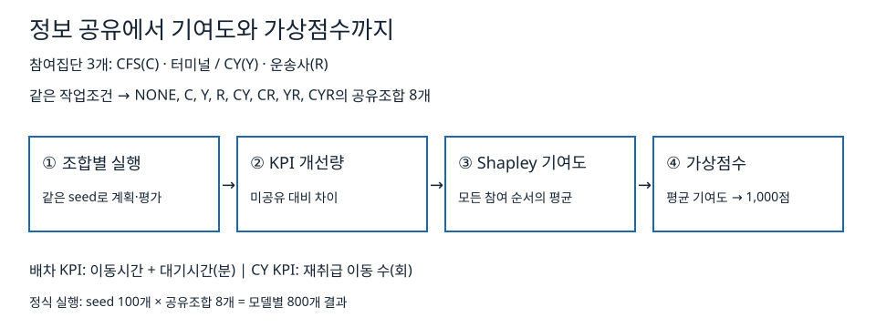

# SOCFAI Incentive Simulator

이 저장소는 데이터 공유에 따른 물류 성과의 변화와 참여자별 기여도를 계산하는 독립형 Python 시뮬레이터이다. 배차와 CY 재취급의 두 사례에서 정보 공유 조건을 비교하고, 계산된 기여도에 따라 가상점수를 배분한다. 실험은 고정된 합성 데이터와 100개 seed를 사용한다.

This standalone Python simulator compares eight information-sharing conditions for dispatch and container-yard retrieval. It attributes KPI improvements using Shapley values and converts aggregate contributions into virtual points.

## 모델 개요



1. 같은 작업조건으로 8개 정보공유 조합을 실행한다.
2. 미공유 대비 KPI 개선량을 구한다.
3. 정보를 추가하는 모든 참여 순서에서 개선량을 평균해 참여자별 기여도를 계산한다.
4. 100개 seed의 평균 기여도에서 양수 부분의 비율을 합계 1,000점으로 변환한다.

## 정보 공유 조건

| 기호 | 배차 사례 | CY 사례 |
|---|---|---|
| C | CFS 운영 정보 | CFS 반출입 예정 정보 |
| Y | 터미널 작업 정보 | CY 운영 정보 |
| R | 운송사 차량 정보 | 운송사 도착 정보 |

| 조합 | 공유 정보 |
|---|---|
| NONE | 고정 공개 기본값 |
| C | CFS |
| Y | 터미널 / CY |
| R | 운송사 |
| CY | CFS와 터미널 / CY |
| CR | CFS와 운송사 |
| YR | 터미널 / CY와 운송사 |
| CYR | 세 참여집단 모두 |

미공유 조건은 해당 참여자의 상세정보 대신 고정 공개 기본값을 사용한다. 배차의 원본 파일은 터미널을 `T`로 저장하므로 `Y`, `CY`, `YR`, `CYR`은 각각 `T`, `CT`, `TR`, `CTR`에 대응한다.

## 결과


| 사례 | 미공유 평균 | 전체공유 평균 | 평균 공유가치 | 가상점수 C / Y / R |
|---|---:|---:|---:|---|
| 배차 | 417.14분 | 344.77분 | 72.37분 감소 | 400 / 9 / 591 |
| CY 재취급 | 4.92회 | 4.12회 | 0.80회 감소 | 0 / 994 / 6 |

각 평균은 같은 seed 100개를 짝지어 계산했다. [결과 파일](results/README.md)에서 통계와 참여자별 기여도를 확인할 수 있다.

## 빠른 실행

Python 3.12와 표준 라이브러리만 사용한다. 저장소를 clone하거나 source ZIP을 해제한 디렉터리에서 실행한다. 패키지 설치는 필요하지 않다.

```sh
python3 tools/reproduce.py --model dispatch --mode smoke --order forward --output outputs/dispatch-smoke
python3 tools/reproduce.py --model cy --mode smoke --order forward --output outputs/cy-smoke
```

smoke는 seed 0과 공유조합 8개를 확인하며 가상점수를 지급하지 않는다. `outputs/<이름>/run/scientific.json`과 `outputs/<이름>/receipt.json`이 생성된다. 출력 디렉터리는 새 이름이어야 한다.

## 정식 재현

```sh
python3 tools/reproduce.py --model dispatch --mode formal --order forward --output outputs/dispatch-formal
python3 tools/reproduce.py --model cy --mode formal --order forward --output outputs/cy-formal
```

각 실행은 seed 100개와 공유조합 800개를 검증한다. `--order reverse`와 새 출력 이름을 사용하면 조합 실행 순서를 뒤집어 재현할 수 있다. `run/`에는 시나리오, 조합별 CSV, 통계, 기여도, 점수와 정규화된 `scientific.json`이 생성된다. receipt에는 Python 버전·실제 import 경로·입력 해시·유효 seed 수·기준 해시 일치 여부가 기록된다. 기준 해시가 다르면 실행은 실패로 종료된다.

| 모델 | formal scientific SHA-256 |
|---|---|
| 배차 | `29bf872d808894c4338635d7cab7fd42f3e8f2d3c35f3a4de96d4cbcfcda8984` |
| CY | `9a52ea4d5bf8ec35a42f6d538f74d92a4eac5d67a50c4a0135ad1aa9f0c47cbb` |

전체 시험:

```sh
PYTHONPATH=src PYTHONDONTWRITEBYTECODE=1 python3 -B -m unittest discover -s tests -v
```

## 저장소 구성

| 경로 | 내용 |
|---|---|
| `src/` | 배차·CY 생성, 계획, 평가와 기여도 계산 |
| `configs/` | 두 모델의 smoke/formal 고정 설정 |
| `tools/reproduce.py` | 입력 무결성·실행·기준 결과 비교 |
| [docs/METHOD.md](docs/METHOD.md) | 공유가치·기여도·점수 계산 |
| [docs/DISPATCH.md](docs/DISPATCH.md) | 배차 정보와 KPI |
| [docs/CY.md](docs/CY.md) | CY 정보와 KPI |
| [results/](results/README.md) | 선별 요약·CSV와 파일 manifest |

## 범위

고정 합성 데이터를 사용하는 독립형 실행이며, 산출 점수는 가상점수다.

## 저자 및 소속

- 박성문
- 인제대학교

## 연구 지원

과제 사사문구(논문 기준): 본 논문은 스마트 항만물류 CFS 구축을 위한 고신뢰 지능형 관제 플랫폼 개발 연구과제(P0026190)로 산업통상자원부의 지원을 받아 수행하였음.

## 라이선스

이 소프트웨어는 [BSD 3-Clause License](LICENSE)에 따라 배포된다.
