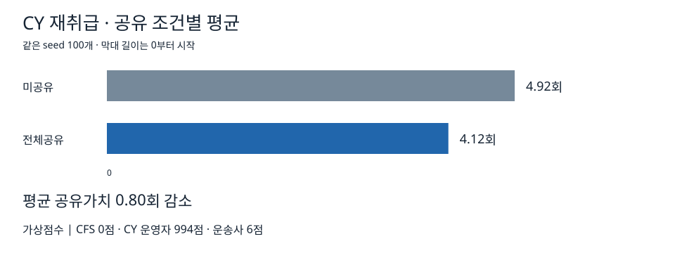

# CY 재취급

장치장(CY)에서 컨테이너 6개의 반출 순서를 계산한다. 후보 순서 720개를 평가하며 KPI는 목표 컨테이너를 꺼내기 위해 옮기는 재취급 이동 수다. 단위는 회이며, 목표 컨테이너 자체의 반출 이동과 구분한다.

## 공유 정보

| 참여집단 | source에서 확인한 필드 |
|---|---|
| CFS (C) | 작업 `ready_at`, `window_start`, `window_end`, `service_minutes`, `priority`, `work_status` |
| CY 운영자 (Y) | `yard_id`, `equipment_open_intervals`, `move_service_minutes`; stack의 `stack_id`, `block_id`, `bay`, `row`, `max_tier`, `stack_bottom_to_top`, `restricted` |
| 운송사 (R) | `current_location_id`, `available_at`, `estimated_arrival_at`, `enabled`, `travel_time_minutes` |

작업·컨테이너 연결 식별자는 비교조건에서 유지한다. 상세정보를 공유하지 않으면 source의 `defaults()`에 정의된 공개 기본값을 사용한다. Y 미공유에서는 실제 적재 위치 대신 목표별 예상 방해 컨테이너 수를 사용한다.

## 결과

100개 seed에서 미공유 평균은 4.92회, 전체공유 평균은 4.12회다. 평균 공유가치는 0.80회다. 가상점수는 CFS 0점, CY 운영자 994점, 운송사 6점이다. CFS의 0점도 결과에 표시한다.

[통계](../results/cy/descriptive_stats.json), [신뢰구간](../results/cy/bootstrap_ci.json), [조합별 결과](../results/cy/coalition_results.csv), [기여도](../results/cy/aggregate_contributions.csv), [가상점수](../results/cy/rewards.csv)에서 원본 값을 확인할 수 있다.
