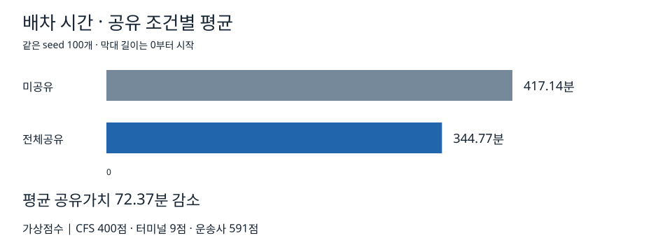

# 배차

12개 작업의 차량 배차와 경로를 계산한다. KPI는 이동시간과 대기시간의 합이며 단위는 분이다. 모든 조합의 계획을 동일한 합성 상태에서 평가한다.

## 공유 정보

| 참여집단 | source에서 확인한 필드 |
|---|---|
| CFS (C) | 작업 `ready_at`, `service_minutes_origin`; CFS 위치의 `server_capacity`, `open_intervals` |
| 터미널 (Y) | 작업 `service_minutes_destination`; 터미널 위치의 `server_capacity`, `open_intervals` |
| 운송사 (R) | 차량 `truck_id`, `start_location_id`, `available_at`, `enabled`; 위치 간 `travel_times` |

배차 source와 결과 CSV는 터미널 기호를 `T`로 저장한다. 문서의 Y는 원본 T에 대응하며, 파일의 조합명과 숫자는 변경하지 않는다. 미공유 정보의 기본값은 [formal 설정](../configs/formal.json)의 `public_defaults`에 있다.

## 결과

100개 seed에서 미공유 평균은 417.14분, 전체공유 평균은 344.77분이다. 평균 공유가치는 72.37분이다. 평균 기여도를 점수로 변환하면 CFS 400점, 터미널 9점, 운송사 591점이다.

[통계](../results/dispatch/descriptive_stats.json), [신뢰구간](../results/dispatch/bootstrap_ci.json), [조합별 결과](../results/dispatch/coalition_results.csv), [기여도](../results/dispatch/aggregate_contributions.csv), [가상점수](../results/dispatch/rewards.csv)에서 원본 값을 확인할 수 있다.
